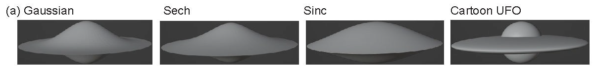
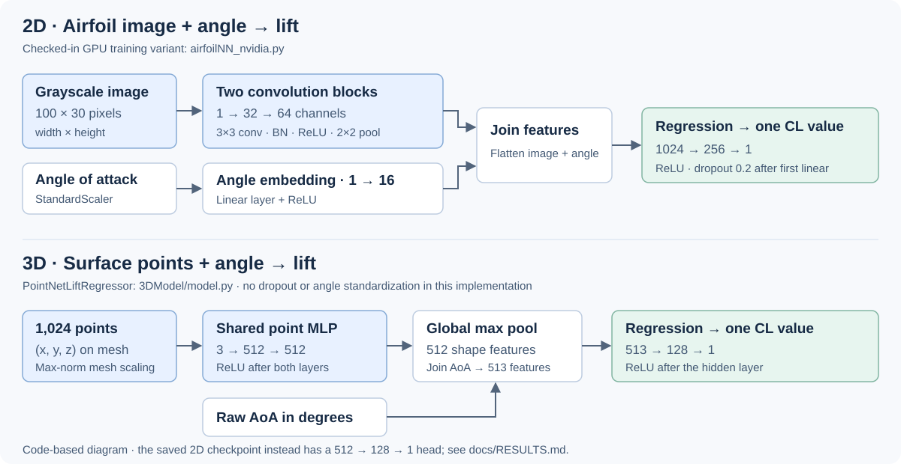
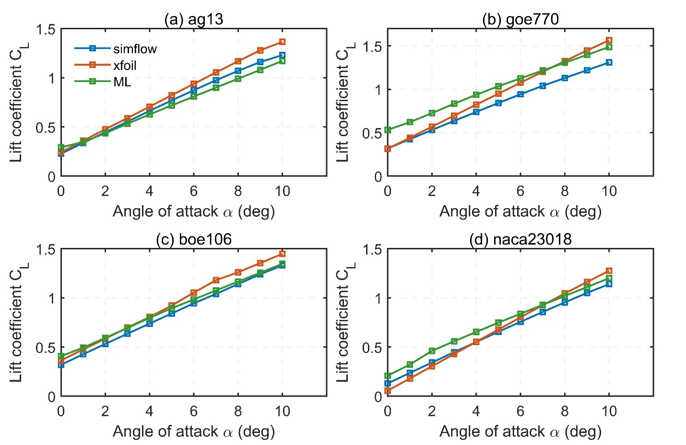
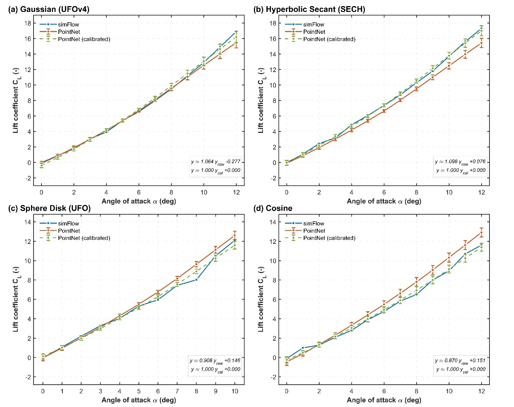

# Learning aerodynamic lift from shape

**An independent high-school project by Alex Yu: building neural-network surrogates for 2D airfoils and 3D flight-vehicle concepts.**

How could I compare more aircraft shapes without running an expensive flow simulation for every design change? I explored that question by combining aerodynamic simulation, geometry generation, and machine learning. The result is two research prototypes that estimate **lift coefficient** from a shape and its angle to the airflow.



*3D concepts explored in the project; cropped from manuscript Figure 4(a). The Gaussian mesh is named `ufov4` in the code.*

[How it works](#how-it-works) · [Results and evidence](#results-and-evidence) · [Code tour](#code-tour) · [Running the project](docs/PROJECT_GUIDE.md#running-the-original-workflows) · [Manuscript source notes](docs/research/README.md)

## Why I built it

Computational fluid dynamics (CFD) estimates how air moves around a body. It can guide engineering decisions, but preparing meshes and solving each case makes broad design exploration costly. A **surrogate** learns from previously calculated examples and estimates the response of another candidate. My goal was to explore this approach for early design screening, with detailed simulations still providing the reference.

I started with airfoils, the cross-sectional shapes of wings, then investigated rounded, axisymmetric pods. Moving into 3D required a different representation: an image describes a wing section, while a cloud of surface points describes a complete body. These are two related experiments, not an automated system that converts a selected airfoil into an optimized vehicle.

## My contributions

I developed the project independently in high school, with **Fei Liu providing advising**. My implementation work covered:

- Automating XFOIL angle sweeps, collecting lift labels, and cleaning the airfoil data.
- Building a PyTorch CNN that combines an airfoil image with angle of attack, including grouped validation and GPU-training experiments.
- Exploring 3D pod shapes in Blender and using SimFlow simulations to compare their aerodynamic responses.
- Implementing a PointNet-style lift regressor, mesh sampling, checkpoint saving, and prediction/export tools for 3D geometry.
- Comparing predictions with solver outputs and investigating systematic prediction bias.

I used established tools and neural-network ideas; I did not develop XFOIL, SimFlow/OpenFOAM, Blender, or the original PointNet architecture. The 18-page research manuscript credits Alex Yu and Fei Liu. Selected figures and [source notes](docs/research/README.md) are included here; the full PDF is not distributed in this repository. No publication or peer-review status is claimed.

## How it works

**Angle of attack (AoA)** is the angle between a shape and the incoming airflow. **Lift coefficient (`CL`)** expresses lift relative to air density, speed, and a reference area, allowing comparisons under defined conditions. **Drag coefficient (`CD`)** describes resistance to motion. Both implemented networks predict **`CL` only**; drag appears in the simulation data and manuscript comparisons.

### 1. A CNN for 2D airfoils

The airfoil workflow uses UIUC profile coordinates and XFOIL-generated labels. The checked-in clean table contains **70,339 airfoil-angle pairs across 1,579 profiles**. The prediction table contains **13,907 pairs across 313 profiles**.

The CNN reads a grayscale airfoil image through two convolution blocks, with 32 then 64 channels. A second branch converts the angle into 16 features. The branches join in a fully connected head that produces one lift estimate. GroupKFold separates examples by **airfoil filename**; this is geometry-level grouping, not demonstrated separation of broader airfoil families.

[`airfoilNN_nvidia.py`](airfoilNN_nvidia.py) is the most developed checked-in GPU training variant. It includes reproducible seed settings, mixed precision, a learning-rate scheduler, and split-list export. Other variants preserve earlier architecture and training choices.

### 2. A PointNet-style surrogate for 3D pods

The 3D workflow loads an OBJ mesh, normalizes its scale, and samples **1,024 surface points**. A shared neural network processes each point, and global max pooling summarizes the shape without requiring a fixed mesh connectivity. The model joins that summary with AoA and predicts lift.



*Diagram follows the checked-in GPU CNN and 3D model definitions. The saved 2D checkpoint uses a different head; see the [architecture comparison](docs/RESULTS.md#architecture-and-training-differences).*

The checked-in 3D training data cover Gaussian (`ufov4`), Sinc, and hyperbolic-secant (`sech`) meshes. Additional sphere-disk and cosine meshes are available for exploration. The manuscript discusses five geometry families, but their complete evaluation data are not all present here.

### Simulation work

XFOIL supplied the 2D lift labels; SimFlow, based on OpenFOAM, supplied the manuscript's CFD comparisons and 3D reference values. Blender supported geometry construction. The 3D CSV also records drag and pitching moment, although training reads only lift.

The manuscript describes incompressible 3D simulations with a k-omega SST turbulence model and nominal Reynolds number of six million. Full SimFlow case directories, convergence logs, and mesh-refinement studies are not included. The 2D generator's operating settings also differ from the manuscript; the [evidence notes](docs/RESULTS.md#simulation-and-data-provenance) record those differences.

## Results and evidence

These results describe agreement with numerical reference labels, not wind-tunnel validation. `R²` measures how well predictions explain variation in those labels; **it is not percentage accuracy**. MAE is average absolute error and RMSE gives more weight to large errors; lower is better.

| Evaluation | Samples | MAE | RMSE | R² | Evidence status |
| --- | ---: | ---: | ---: | ---: | --- |
| 2D CNN, raw predictions | 13,907 | 0.3253 | 0.3466 | 0.2276 | Recomputed from the committed prediction CSV; matches manuscript Table 1 |
| 2D CNN, calibrated | 13,907 | 0.05223 | 0.0779 | 0.9610 | Reported in Table 1; independent calibration split unavailable |
| 3D PointNet, calibrated | 63 reported | — | — | 0.9955 | Reported in manuscript text; full prediction data unavailable |

Calibration applies a fitted scale and offset: `CL_calibrated = a * CL_raw + b`. Fitting this map on the **same 13,907 saved 2D predictions used for scoring** reproduces Table 1 to its reported precision. That is a useful bias diagnostic, but it does not verify the manuscript's claim that calibration used disjoint data.

For 3D, Table 2 lists an average calibrated `R² = 0.9924`, while the text reports a global `R² = 0.9955` and Pearson correlation `r = 0.9977`. These summaries are not interchangeable. The repository has **45 CFD rows across three meshes**, rather than the reported 63 cases across five families, and no saved 3D weights or seed-level predictions. [Full metric reconciliation and limitations →](docs/RESULTS.md)



*Original manuscript Figure 2. These are the manuscript's selected comparison curves, not a new evaluation of the saved model. The source does not identify the ML curve's calibration status.*



*Original manuscript Figure 6. Its caption describes means and standard deviations over eight runs. The underlying run outputs are absent, so those error bars and calibrated results have not been independently reproduced.*

## Engineering challenges and lessons

- **Geometry changes the problem.** A useful 2D profile does not automatically make a useful 3D body. I explored analytic pod shapes and a point-cloud representation rather than assuming sectional results would transfer directly.
- **Data preparation matters.** Solver failures, duplicate samples, image memory use, and mesh formats required work alongside the networks. XFOIL automation records failures and supports skipping previously successful profiles.
- **Good trends can hide numerical bias.** The large difference between raw and calibrated 2D scores shows why prediction plots and error metrics both matter. Calibration needs its own held-out data to support a generalization claim.
- **An experiment needs a complete record.** The current snapshot preserves substantial code and data, but differences among scripts, checkpoints, and manuscript settings limit exact reproduction. Capturing consistent preprocessing, splits, calibration parameters, and run outputs is the clearest next improvement.

The practical direction is faster candidate screening before further CFD work. This project does not establish performance across arbitrary shapes, flow conditions, or stall regimes, and no measured inference-speed benchmark is included.

## Code tour

| Start here | Purpose |
| --- | --- |
| [`generate_airfoil_data.py`](generate_airfoil_data.py), [`data_csv_cleanup.py`](data_csv_cleanup.py) | Batch XFOIL generation and table cleanup |
| [`airfoilNN_nvidia.py`](airfoilNN_nvidia.py) | GPU-oriented 2D CNN training variant |
| [`airfoilNN_predict.py`](airfoilNN_predict.py) | Historical 2D prediction and CSV/scatter export; architecture reconciliation required |
| [`3DModel/model.py`](3DModel/model.py), [`flightpod_dataset.py`](3DModel/flightpod_dataset.py) | 3D network, mesh normalization, and surface sampling |
| [`3DModel/train.py`](3DModel/train.py), [`predict.py`](3DModel/predict.py) | 3D training, checkpoints, lift sweeps, and export |
| [`blender/model1.py`](blender/model1.py) | Example Blender surface-of-revolution generator and renderer |
| [`tools/audit_saved_results.py`](tools/audit_saved_results.py) | Dependency-free audit of the saved CSV results; no model execution |
| [`experiments/`](experiments/README.md) | Preserved learning exercises, separated from the aerodynamic workflows |

The original datasets, model file, meshes, and aerodynamic script paths are preserved. See the [project guide](docs/PROJECT_GUIDE.md) for the full layout, variant differences, prerequisites, and execution caveats.

To inspect the saved evidence with Python's standard library:

```sh
git clone https://github.com/W0R1D-D0M1NAT10N/airfoil_cnn.git
cd airfoil_cnn
python tools/audit_saved_results.py
```

Training and inference require additional tools and missing artifacts described in the guide. This documentation update recalculates saved-table metrics; it does not rerun training, inference, XFOIL, or CFD.

## Sources and credits

Airfoil coordinates originate from the [UIUC Airfoil Coordinates Database](https://m-selig.ae.illinois.edu/ads/coord_database.html). The project uses [XFOIL](https://web.mit.edu/drela/Public/web/xfoil/), [SimFlow](https://sim-flow.com/), [OpenFOAM](https://www.openfoam.com/), [Blender](https://www.blender.org/), PyTorch, and PyTorch3D. The 3D network adapts the shared-point-features and pooling idea from [PointNet](https://arxiv.org/abs/1612.00593).

Figures are extracted from the project manuscript; [asset provenance](docs/assets/README.md) identifies their pages and caveats. Fei Liu is credited for advising and as a manuscript coauthor.
